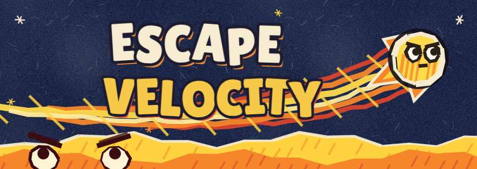
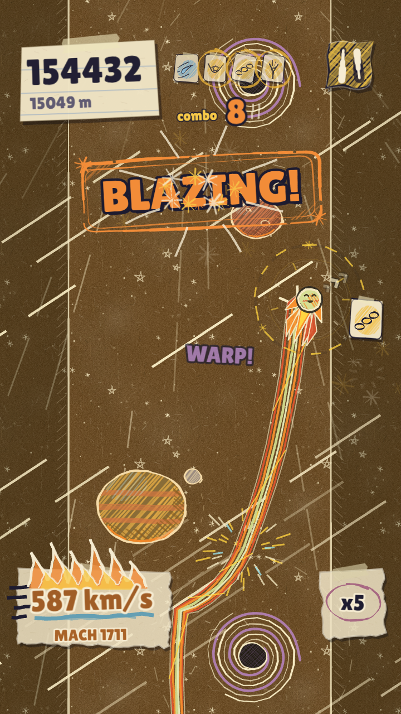
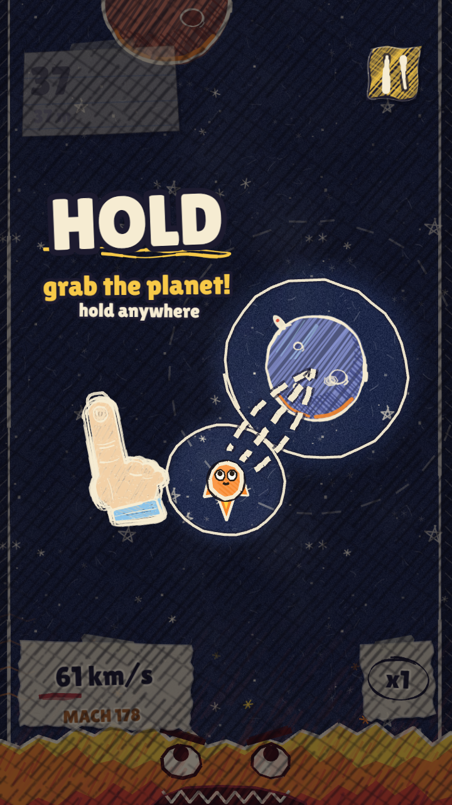
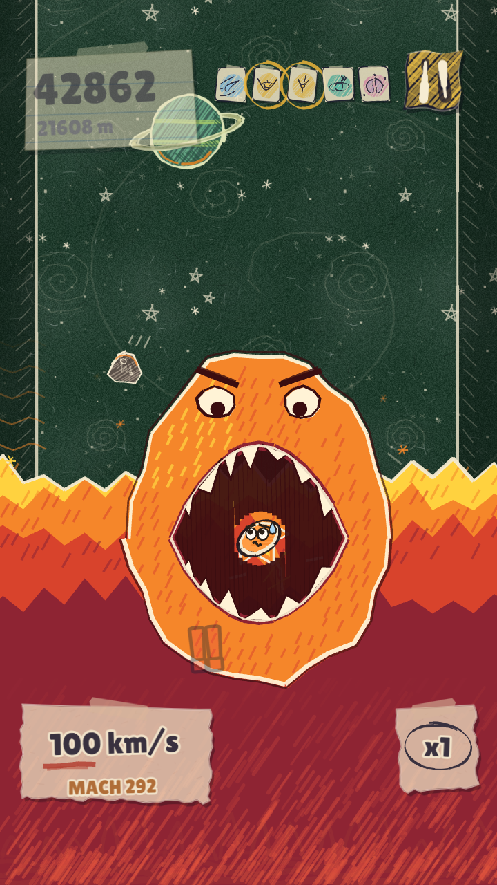
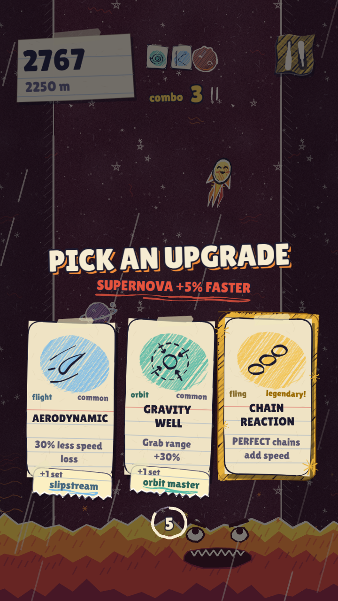

<p align="center"></p>

<p align="center"><b>You are a comet. A supernova is eating the sky behind you. Go faster.</b><br>
Hold to grab a planet. Let go to fling. Outrun the supernova.</p>

<p align="center"><a href="https://behlulakdag.itch.io/escape-velocity"><b>▶ Play it in your browser on itch.io</b></a> · made in 48 hours for <a href="https://itch.io/jam/slapjam-ai-2">Slapjam #2</a> (theme: <b>Speed</b>)</p>

---

**Escape Velocity** is a one-thumb arcade game for phones (portrait), drawn like a sketchbook: gel-pen ink, crayon hatching and a new sheet of paper for every zone. Swing around planets to steal their speed, fling yourself up the page, and stay ahead of a very grumpy supernova. The faster you go, the faster you gain.

<p align="center">
  
  
  
  
</p>

## How to play

- **Planets are your friends.** Their gravity is how you speed up.
- **Hold** anywhere on the screen near a planet to lock into orbit. Every lap makes you faster; closer orbits gain more.
- **Let go** when the aim line points at the next planet. A **gold** aim is a PERFECT: chain them for combos.
- Each new zone turns the page: **pick 1 of 3 upgrade cards** and build your run.
- Desktop: hold the mouse button or **Space**. The **||** button pauses.

## Features

- Hand-drawn look made entirely in code: no image files, every planet, card and face is drawn at runtime
- A one-time slow-motion guided tutorial on your first run
- 12 upgrade cards in 4 families with set bonuses
- Endless pages: Liftoff, Orbit, Hypersonic, Warp Speed, Hyperspace, Escape Velocity, Lightspeed, Wormhole, Event Horizon, Big Bang, Beyond...
- Missions that pay coins, 7 comet skins, a card journal, MACH readout and stamps
- Procedural music and sound effects (Web Audio, no audio files)

## Run it locally

No build step, no dependencies: open `index.html` in a browser, or serve the folder:

```bash
npx serve .
```

Tests (pure game logic, Node 18+):

```bash
node --test tests/*.test.js
```

`tests/playtest-bot.js` is a headless bot that plays thousands of runs to tune the balance (see its header).

## Project layout

| Path | What |
|---|---|
| `index.html` | Entry point (plain classic scripts, no bundler) |
| `src/config.js`, `src/utils.js` | Constants, hand-drawn UI helpers |
| `src/orbit.js` | Pure orbit / speed / supernova math (unit-tested) |
| `src/art.js`, `src/cardart.js` | All the sketchbook drawing |
| `src/cards.js`, `src/progress.js` | Upgrade cards, missions, coins, skins |
| `src/audio.js` | Procedural Web Audio music and sound |
| `src/scenes/` | Phaser scenes (Boot, Menu, Game, Hud, Cards, Pause, GameOver, Shop, Journal) |
| `tests/` | Node unit tests and the playtest bot |
| `itch/` | itch.io page text, screenshots, banner |

## Credits

- Made with [Phaser 3.90](https://phaser.io) (MIT, see `lib/PHASER-LICENSE.txt`)
- Font: [Lilita One](https://fonts.google.com/specimen/Lilita+One) by Juan Montoreano (SIL Open Font License, see `assets/fonts/OFL.txt`)
- AI tools used: Claude Code (code, in-code drawings, procedural audio), directed and playtested by the author and friends

## License

The game's code and assets are released under the **GNU General Public License v3.0** (see `LICENSE`). Phaser and Lilita One keep their own licenses.
