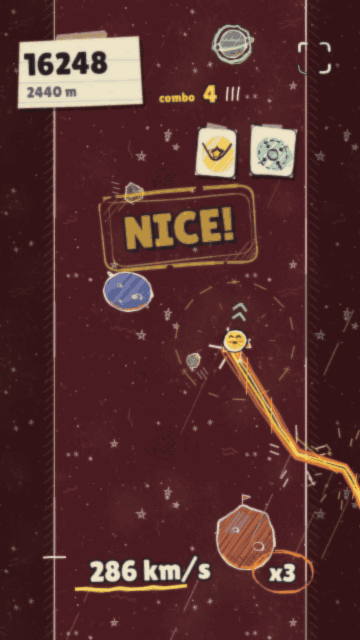

# Escape Velocity

**You are a comet. A supernova is eating the sky behind you. Go faster.**

**Drawn like a sketchbook, not generated:** gel-pen ink, crayon hatching and a new paper page for every zone.

**Speed is your life, your score and your way out.**

The faster you go, the faster you gain - experts break 600-800 km/s.

Made in 48 hours for Slapjam #2. Theme: **Speed**.

## Speed is everything

Speed is your life, your score and your way out. Swing around planets to pick it up, fling yourself up the page, and stay ahead of the grumpy supernova climbing up from below. Slow down and it catches you.

## How to play

- **HOLD** near a planet to lock into orbit. Each lap makes you faster, and closer orbits gain more.
- **RELEASE** when the aim line turns **GOLD** to fling. Gold is a PERFECT: chain them for combos.
- **HOLD** again near the next planet to catch it, and keep the chain going.
- Each new zone turns the page. **Pick 1 of 3 upgrade cards** and build your run.
- Don't bump into planets or asteroids, and keep away from the supernova.

## Features

- Hand-drawn sketchbook look: gel-pen ink, crayon hatching, and a new paper page for every zone (Liftoff, Orbit, Hypersonic, Warp Speed, Hyperspace... and Escape Velocity)
- 12 upgrade cards in 4 families (Orbit, Fling, Flight, Shield). Collect a full family for a set bonus such as Sharpshooter or Unbreakable
- Momentum: every speed gain snowballs, and a flame crown grows on your speedometer
- PERFECT chains, combo milestones and close calls that slow time down
- Procedural music and sound effects that react to your speed and danger
- Runs last from 30 seconds to a few minutes, and RETRY is instant

## Controls

- **Phone / tablet:** touch and hold anywhere, then let go. Plays in portrait.
- **Desktop:** hold the mouse button or **SPACE**.
- The fullscreen button (top right) is worth it on phones.

## Credits & tools

- Built with **Phaser 3.90** (HTML5, plain JavaScript).
- Code, art and audio were made with **Claude Code** (Anthropic), an AI coding agent.
- All art is drawn in code at runtime (no image files). All audio is procedural Web Audio (no audio files).
- Font: **Lilita One** by Juan Montoreano (SIL Open Font License).
